# AWS Lab: Monitoring Infrastructure with CloudWatch, EventBridge and AWS Config

Hands-on lab completed on **16 Nov 2026** in **us-west-2 (Oregon)**. I used the CloudWatch agent, CloudWatch Logs, CloudWatch Metrics and alarms, EventBridge, SNS and AWS Config to monitor an EC2 web server.

> Screenshots have been redacted (account IDs, instance and resource IDs, IP addresses, email addresses and ARNs are blurred). The original lab guide is AWS training material and is not reproduced here; this repo contains my own notes and configuration.

## What I built

| # | Task | Services |
|---|------|----------|
| 1 | Install and configure the CloudWatch agent | Systems Manager Run Command, Parameter Store |
| 2 | Ship Apache logs, create a 404 metric filter and alarm | CloudWatch Logs, CloudWatch Alarms, SNS |
| 3 | Inspect OS-level metrics (disk, memory, swap) | CloudWatch Metrics (`CWAgent` namespace) |
| 4 | Real-time notification when an instance stops or terminates | EventBridge, SNS |
| 5 | Compliance checks for tags and unattached EBS volumes | AWS Config |

The agent configuration I stored in Parameter Store is in [`config/cloudwatch-agent-config.json`](config/cloudwatch-agent-config.json).

## Walkthrough

### Task 1: Install and configure the CloudWatch agent

Installed the agent with the `AWS-ConfigureAWSPackage` document, stored a JSON config in Parameter Store (`Monitor-Web-Server`), then started the agent with `AmazonCloudWatch-ManageAgent` (configure, ec2, ssm source, restart).

**Run Command output: AWS-ConfigureAWSPackage step 1 completes successfully**

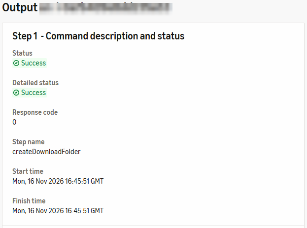

**Output confirming `AmazonCloudWatchAgent` was installed**


**Creating the `Monitor-Web-Server` parameter in Parameter Store**


**Selecting the `AmazonCloudWatch-ManageAgent` document**


**Command parameters: configure / ec2 / ssm / `Monitor-Web-Server` / restart**


**Targeting the Web Server instance manually**

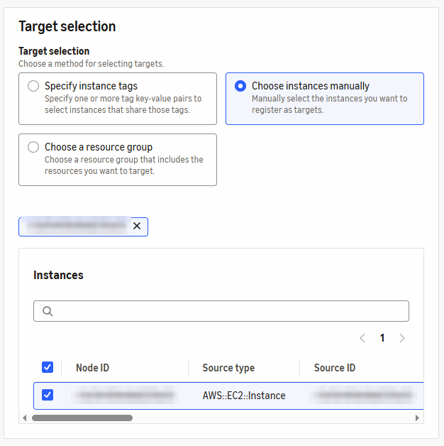

**Command status: Success**

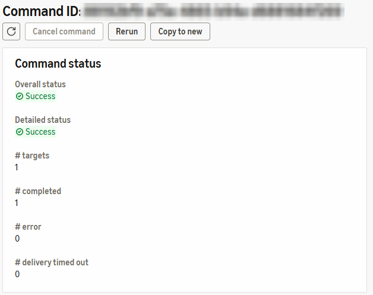


### Task 2: Application logs, metric filter and alarm

Generated 404s by requesting nonexistent pages, confirmed the access log in CloudWatch Logs, created a metric filter (`status_code=404`) that feeds `LogMetrics/404Errors`, and an alarm that fires at 5 or more 404s per minute.

**Web server test page reachable on its public IP**

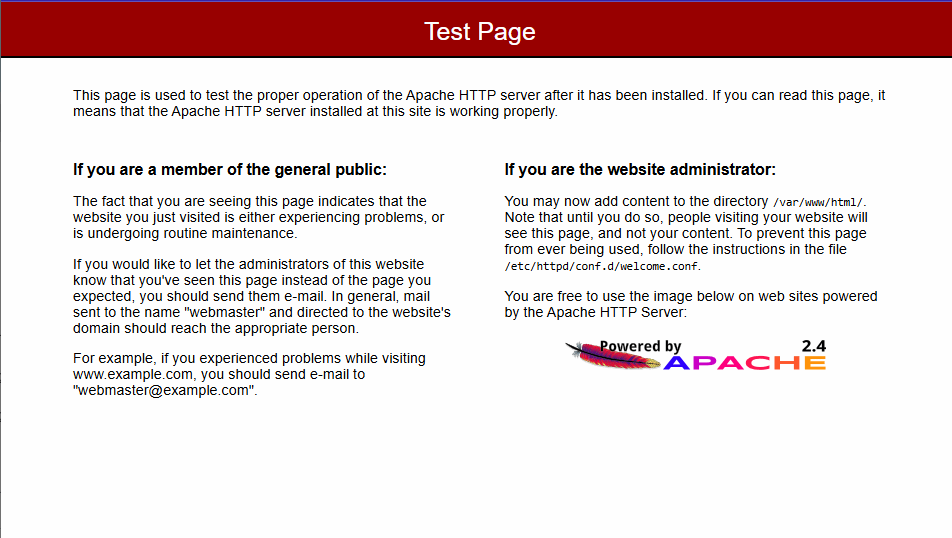

**Requesting `/start` returns 404 Not Found (generates log data)**


**Log stream in `HttpAccessLog` (named after the instance ID)**


**Access log events delivered to CloudWatch Logs**

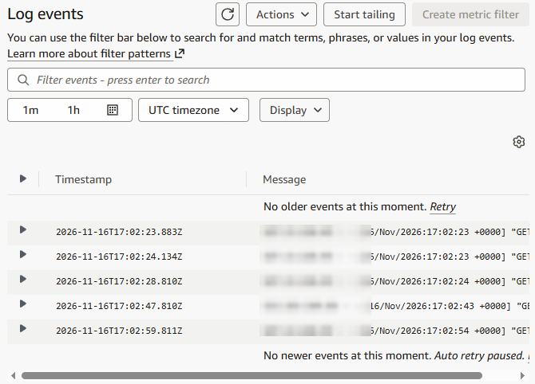

**Expanded event showing the `GET /start` request with status 404**


**Filter pattern `[ip, id, user, timestamp, request, status_code=404, size]` and test**

![Filter pattern `[ip, id, user, timestamp, request, status_code=404, size]` and test](images/13-metric-filter-pattern-test.png)

**Test results: 2 of 5 sample events matched with status 404**

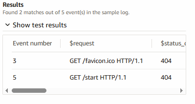

**Assigning metric `LogMetrics / 404Errors` with value 1**


**Review and create the metric filter**

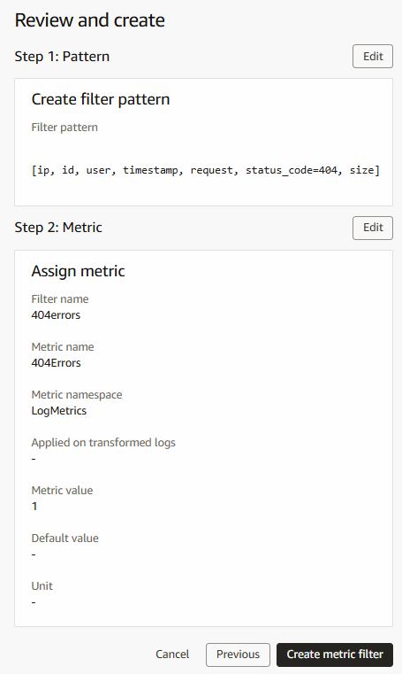

**Metric filter created**

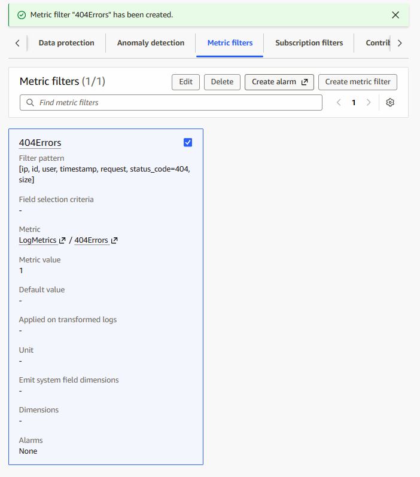

**Alarm condition: `404Errors` >= 5 per 1 minute**


**Alarm notification to an SNS topic**

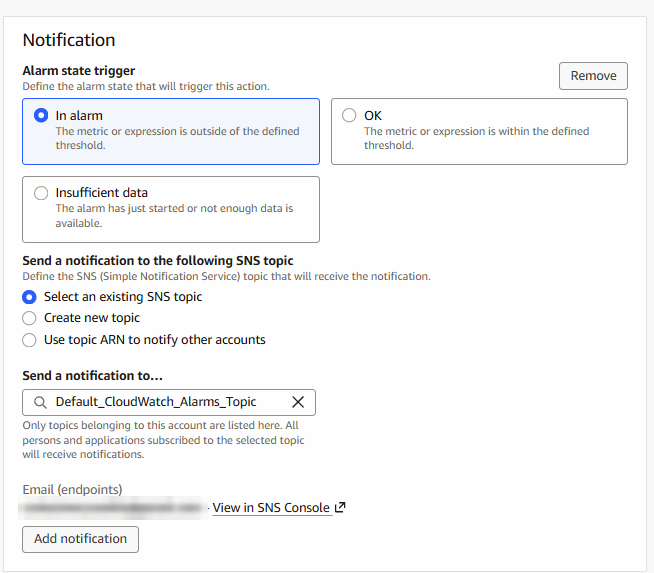

**Alarm name and description**

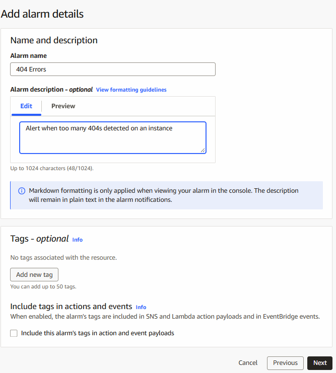

**Preview and create: metric and period**

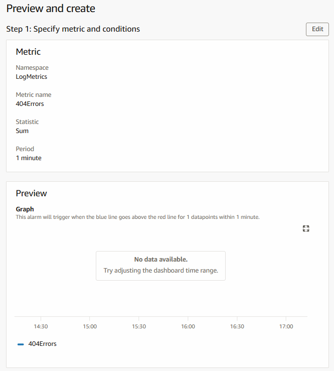

**Review of conditions, actions and details**

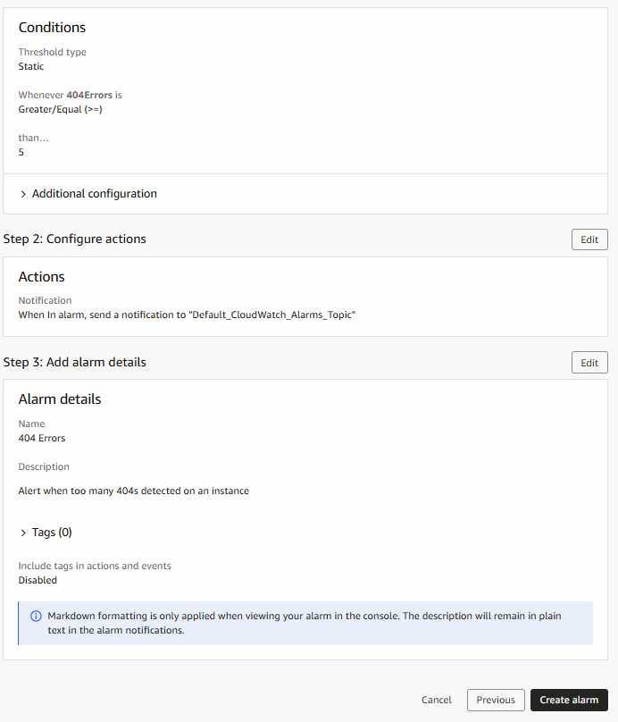

**Confirming the SNS email subscription**

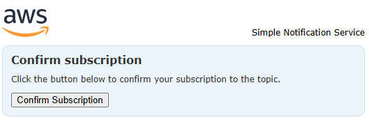

**Alarm in the ALARM state on the CloudWatch overview**

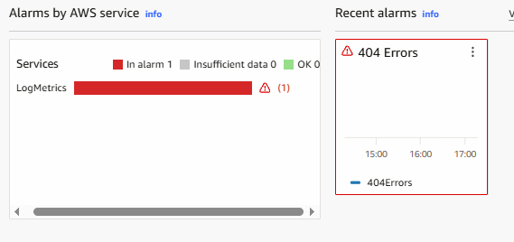

**Alarm notification email**

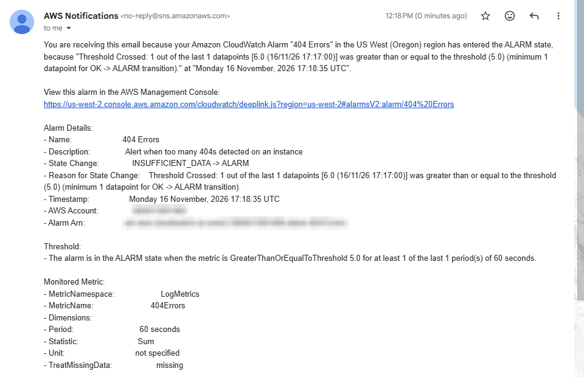


### Task 3: Instance metrics

The agent publishes metrics that EC2 cannot see from outside the VM (memory, swap, disk used).

**Web Server instance in the EC2 console (Monitoring tab source)**

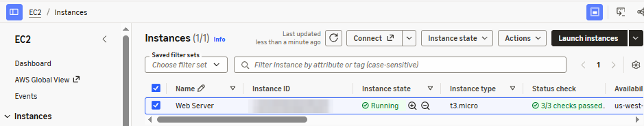

**Custom namespaces `CWAgent` and `LogMetrics` in CloudWatch Metrics**


**Disk metrics collected by the agent (device, fstype, host, path)**

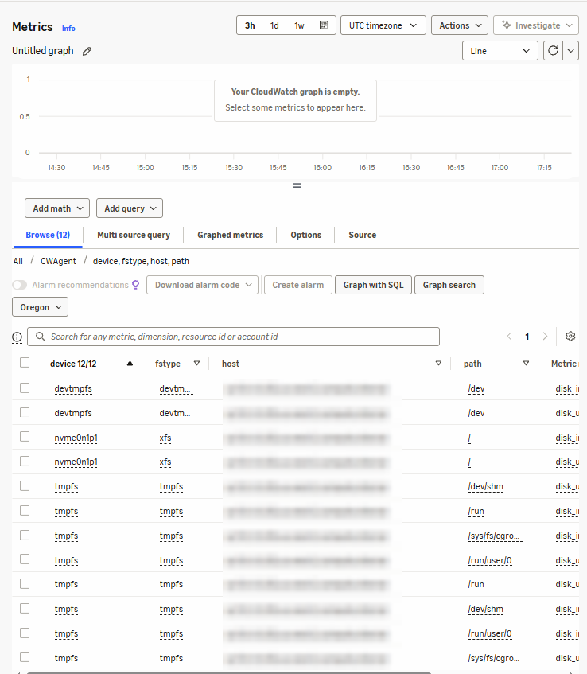

**Memory and swap metrics collected by the agent (by host)**

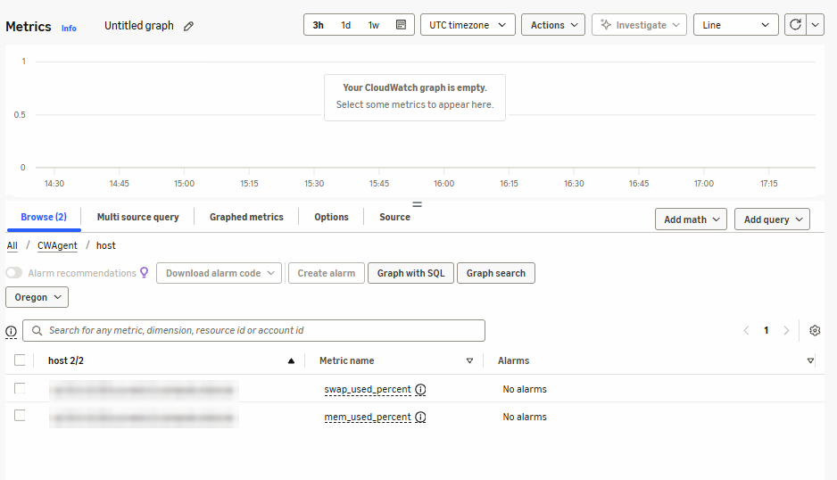


### Task 4: Real-time notifications

Created an EventBridge rule matching EC2 state changes to `stopped` or `terminated` and routed it to an SNS topic, then stopped the instance to test it.

**EventBridge default event bus**

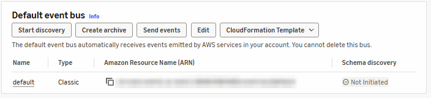

**Event pattern rules on the default bus, with Create rule**

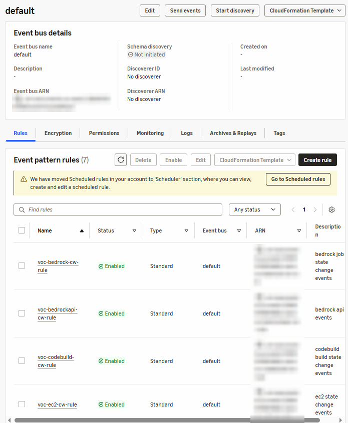

**Advanced builder: building the event pattern**

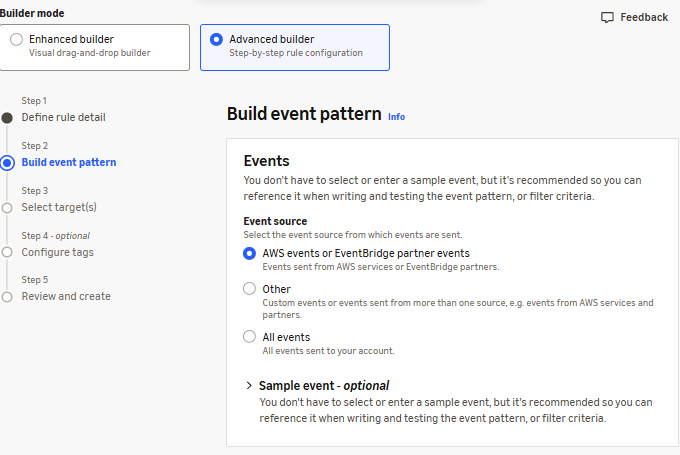

**EC2 Instance State-change Notification for `stopped` and `terminated`**


**Target: SNS topic `Default_CloudWatch_Alarms_Topic`**


**Rule `Instance_Stopped_Terminated` created**


**SNS topic with the confirmed email subscription**

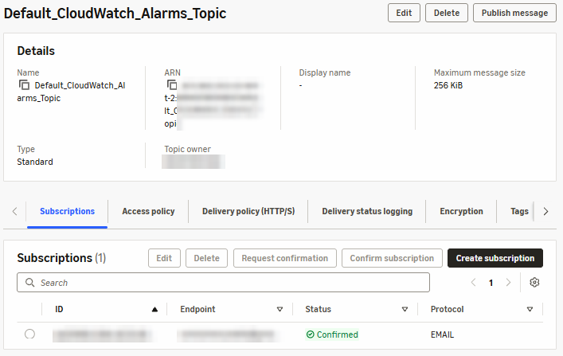

**Stopping the Web Server instance to trigger the rule**

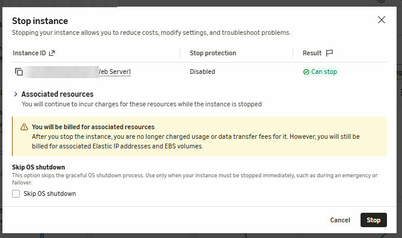

**State-change notification email (JSON body)**

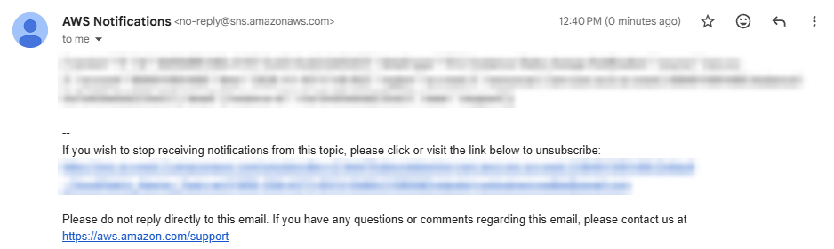


### Task 5: AWS Config compliance

Enabled the `required-tags` rule (tag key `project`) and `ec2-volume-inuse-check`.

**AWS Config: selecting the `required-tags` managed rule**


**AWS Config: selecting `ec2-volume-inuse-check`**


**Both Config rules active**

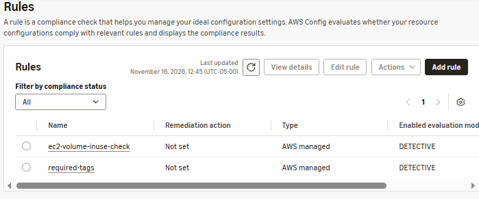

**Non-compliant resources for `required-tags`**


**Non-compliant volume for `ec2-volume-inuse-check`**


## Troubleshooting and lessons learned

The lab guide is older than the current console, so a few things moved:

- **Log groups** are now under *CloudWatch > Logs > Log management*.
- **Metrics** are now under *CloudWatch > Metrics*, and the agent metrics appear in the `CWAgent` custom namespace.
- **CloudWatch Events** is now **Amazon EventBridge**. Go to *Event buses > default > Create rule*, then use the **Advanced builder** and enter the lab values.
- **AWS Config** may need first-time setup through the online guide before rules can be added.
- The agent output step may show a skipped Windows-only step; that is expected on a Linux AMI.
- The alarm briefly shows *Insufficient data* until the first metric datapoint arrives.

## Repo layout

```
.
├── README.md
├── config/cloudwatch-agent-config.json
└── images/            # redacted screenshots, numbered in lab order
```
